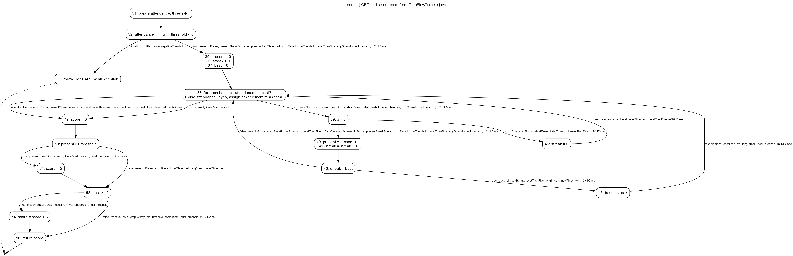

# Lab 10 — Definition–Use хосууд

**Оюутан:** Б. Энхбаяр  
**Оюутны код:** B232270018

Орчны гаралт (энэ ажлыг гүйцэтгэх үед):

```text
$ java -version
openjdk version "17.0.20.1" 2026-08-18
OpenJDK Runtime Environment Temurin-17.0.20.1+1 (build 17.0.20.1+1)
OpenJDK 64-Bit Server VM Temurin-17.0.20.1+1 (build 17.0.20.1+1, mixed mode, sharing)

$ mvn -version
Apache Maven 3.9.15 (98b2cdbfdb5f1ac8781f537ea9acccaed7922349)
Maven home: C:\Program Files\apache-maven-3.9.15
Java version: 21.0.5, vendor: Eclipse Adoptium, runtime: C:\Program Files\Eclipse Adoptium\jdk-21.0.5.11-hotspot
Default locale: en_US, platform encoding: UTF-8
OS name: "windows 11", version: "10.0", arch: "amd64", family: "windows"
```

## A. `gcd(x, y)` DU анализ

Доорх мөрийн дугаар нь `DataFlowTargets.java` файлын дугаар. `T/F` нь predicate-use-ийн салааг тэмдэглэв. Замын товч бичлэг `15-T → 16 → 17 → 18 → 15` гэх мэтээр гүйцэтгэсэн мөрүүдийг заана.

| Хувьсагч | Def мөр | Use мөр | Төрөл | Def-clear зам | Тестийн ID | Хамрагдсан |
|---|---:|---:|---|---|---|---|
| x | 13 | 16 | c-use | `13 → 15-T → 16` | `gcdOneLoopIteration`, `gcdMultipleLoopIterations` | Тийм |
| x | 13 | 20 | c-use | `13 → 15-F → 20` (давталтгүй зам) | `gcdZeroSecondArgument` | Тийм |
| x | 17 | 16 | c-use | `17 → 18 → 15-T → 16` | `gcdMultipleLoopIterations` | Тийм |
| x | 17 | 20 | c-use | `17 → 18 → 15-F → 20` | `gcdOneLoopIteration`, `gcdMultipleLoopIterations` | Тийм |
| y | 13 | 15 | p-use, T | `13 → 15-T` | `gcdOneLoopIteration`, `gcdMultipleLoopIterations` | Тийм |
| y | 13 | 15 | p-use, F | `13 → 15-F` | `gcdZeroSecondArgument` | Тийм |
| y | 13 | 16 | c-use | `13 → 15-T → 16` | `gcdOneLoopIteration`, `gcdMultipleLoopIterations` | Тийм |
| y | 13 | 17 | c-use | `13 → 15-T → 16 → 17` | `gcdOneLoopIteration`, `gcdMultipleLoopIterations` | Тийм |
| y | 18 | 15 | p-use, T | `18 → 15-T` (дараагийн давталтын шалгалт) | `gcdMultipleLoopIterations` | Тийм |
| y | 18 | 15 | p-use, F | `18 → 15-F` (давталт дуусах шалгалт) | `gcdOneLoopIteration`, `gcdMultipleLoopIterations` | Тийм |
| y | 18 | 16 | c-use | `18 → 15-T → 16` | `gcdMultipleLoopIterations` | Тийм |
| y | 18 | 17 | c-use | `18 → 15-T → 16 → 17` | `gcdMultipleLoopIterations` | Тийм |
| tmp | 16 | 18 | c-use | `16 → 17 → 18` | `gcdOneLoopIteration`, `gcdMultipleLoopIterations` | Тийм |

`gcd(7, 0)` ганцаараа давталтгүй `x`-ийн 13-р мөрийн тодорхойлолтоос 20-р мөрийн use хүртэлх хосыг, мөн `y`-ийн 13-р мөрийн тодорхойлолтоос 15-р мөрийн худал салааг хамарна. `gcd(12, 8)` хоёр давталт хийж, 18-р мөрөнд тодорхойлогдсон `y` ба 17-р мөрөнд тодорхойлогдсон `x` дараагийн давталтад use-д хүрэх хосуудыг хамарна. Тиймээс эхний давталттай кейс болон олон давталттай кейс хоёулаа шаардлагатай.

## B. `bonus(attendance, threshold)`

### B4. Эхний шат — all-defs

`BonusTest.allDefsResetAndNoBonus` болон `BonusTest.allDefsPresentAndStreakBonus` хоёр тест бүх definition-ийг дор хаяж нэг хэрэглээнд хүргэнэ. Хоёр тестээс цөөн байж болохгүй: 49-р мөрийн `score = 0` тодорхойлолт хэрэглэгдэхийн тулд 50-р мөрийн нөхцөл худал байх ёстой; 51-р мөрийн `score = 5` тодорхойлолтыг үүсгэхийн тулд мөн нөхцөл үнэн байх ёстой. Нэг гүйцэтгэлд энэ нөхцөл хоёр өөр утгатай байх боломжгүй. Эхний тест 46-р мөрийн `streak = 0` тодорхойлолтыг дараагийн эерэг ирцийн мөчлөгийн 41-р мөрийн c-use-д хүргэнэ. Хоёр дахь тест 43-р мөрийн `best` тодорхойлолт, 54-р мөрийн `score` тодорхойлолтуудыг use-д хүргэнэ.

`results/mvn-verify-alldefs.txt`-д нийт 5 тест амжилттай (GCD 3, bonus all-defs 2) гарсан. `results/jacoco-alldefs.csv` дахь `DataFlowTargets` мөр: Branch 14/16, Line 23/25 (7-р мөрийн далд constructor болон 33-р мөрийн exception statement хамрагдаагүй). Иймд all-defs хангагдсан ч branch 100% биш байж болно.

Бүрэн DU тестийн шатанд `results/mvn-verify-final.txt` нийт 12 тест амжилттай, `results/jacoco-final.csv` Branch 16/16, Line 24/25 гэж харуулна. Branch 100% нь DU хамралтыг батлахгүй: `gcd(7,0)` болон `gcd(0,5)` нь `while (y != 0)`-ийн T, F салбар хоёуланг хамруулна, гэхдээ олон давталтын `x`-ийн 17-р мөрөөс 16-р мөр рүү болон `y`-ийн 18-р мөрөөс 16/17-р мөрийн use-д хүрэх DU хосуудыг хамруулахгүй. `gcd(12,8)` шиг олон давталттай тест тэдгээрийг шаарддаг. Иймээс branch тоо шийдвэр бүрийн салаа гүйцэтгэснийг хэлдэг бол DU хүснэгт тодорхой definition-ээс use хүртэлх def-clear замыг шалгана.

### B1. Control-flow graph



38-р мөрийн for-each нөхцөл нь `attendance`-ийн p-use: дараагийн элемент байвал 38-р мөрд `a` хувьсагчид онооно, үгүй бол давталтаас гарна. Графын ирмэг дээр тухайн шилжилтийг гаргасан бодит тестийн методыг бичсэн.

### B2. Definition/use жагсаалт

| Хувьсагч | Def мөр | Use мөр ба төрөл |
|---|---|---|
| `attendance` | 31 (параметр) | 32 p-use (`attendance == null`); 38 p-use (дараагийн элемент байгаа эсэх) |
| `threshold` | 31 (параметр) | 32 p-use (`threshold < 0`, эхний нөхцөл худал үед); 50 p-use (`present >= threshold`) |
| `present` | 35, 40 | 40 c-use (өөрийн баруун тал); 50 p-use |
| `streak` | 36, 41, 46 | 41 c-use (өөрийн баруун тал); 42 p-use |
| `best` | 37, 43 | 42 p-use; 53 p-use |
| `a` | 38 (for-each-ийн оноолт) | 39 p-use (`a > 0`) |
| `score` | 49, 51, 54 | 54 c-use (өөрийн баруун тал); 56 c-use |

### B3. Def-clear DU хосууд

Замын тэмдэглэгээнд зөвхөн DU-д хамаарах мөрүүдийг харуулав; `38-T` нь дараагийн ирцийн элемент байгаа, `38-F` нь давталт дууссаныг илтгэнэ. Мөр 32-ын `attendance` болон `threshold` p-use нь short-circuit нөхцөл тул тусдаа хувьсагчийн шалгалтыг ялгаж тэмдэглэв.

| Хувьсагч | Def | Use | Төрөл/салаа | Def-clear зам | Тестийн ID |
|---|---:|---:|---|---|---|
| attendance | 31 | 32 | p-use, null=T | `31 → 32-T` | `duNullAttendance` |
| attendance | 31 | 32 | p-use, null=F | `31 → 32-F` | `allDefsResetAndNoBonus` |
| attendance | 31 | 38 | p-use, T | `31 → 32-F → 35 → 38-T` | `allDefsResetAndNoBonus` |
| attendance | 31 | 38 | p-use, F | `31 → 32-F → 35 → 38-F` | `duEmptyArrayThresholdZero` |
| threshold | 31 | 32 | p-use, `<0`=T | `31 → 32` (attendance null биш) | `duNegativeThreshold` |
| threshold | 31 | 32 | p-use, `<0`=F | `31 → 32-F` | `allDefsResetAndNoBonus` |
| threshold | 31 | 50 | p-use, T | `31 → 32-F → 35 → 38 → 49 → 50-T` | `duEmptyArrayThresholdZero`, `duResetThenFiveAndThresholdMet` |
| threshold | 31 | 50 | p-use, F | `31 → 32-F → 35 → 38 → 49 → 50-F` | `allDefsResetAndNoBonus`, `duShortResetAndUnderThreshold` |
| present | 35 | 40 | c-use | `35 → 38-T → 39-T → 40` | `allDefsResetAndNoBonus` |
| present | 35 | 50 | p-use, T | `35 → 38-F → 49 → 50-T` | `duEmptyArrayThresholdZero` |
| present | 35 | 50 | p-use, F | `35 → 38-F → 49 → 50-F` | `allDefsResetAndNoBonus` |
| present | 40 | 40 | c-use | `40 → 38-T → 39-T → 40` | `allDefsPresentAndStreakBonus` |
| present | 40 | 50 | p-use, T | `40 → 38-F → 49 → 50-T` | `duResetThenFiveAndThresholdMet` |
| present | 40 | 50 | p-use, F | `40 → 38-F → 49 → 50-F` | `duShortResetAndUnderThreshold` |
| streak | 36 | 41 | c-use | `36 → 38-T → 39-T → 41` | `allDefsPresentAndStreakBonus` |
| streak | 41 | 41 | c-use | `41 → 42 → 38-T → 39-T → 41` | `allDefsPresentAndStreakBonus` |
| streak | 41 | 42 | p-use, T | `41 → 42-T` | `allDefsPresentAndStreakBonus` |
| streak | 41 | 42 | p-use, F | `41 → 42-F` (шинэ streak өмнөх best-ээс их биш) | `allDefsResetAndNoBonus` |
| streak | 46 | 41 | c-use | `46 → 38-T → 39-T → 41` | `duShortResetAndUnderThreshold` |
| best | 37 | 42 | p-use, T | `37 → 38-T → 39-T → 41 → 42-T` | `allDefsPresentAndStreakBonus` |
| best | 37 | 53 | p-use, F | `37 → 38-F → 49 → 50 → 53-F` | `duEmptyArrayThresholdZero` |
| best | 43 | 42 | p-use, T | `43 → 38-T → 39-T → 41 → 42-T` | `duResetThenFiveAndThresholdMet` |
| best | 43 | 42 | p-use, F | `43 → 38-T → 39-T → 41 → 42-F` | `duResetThenFiveAndThresholdMet` |
| best | 43 | 53 | p-use, T | `43 → 38-F → 49 → 50 → 53-T` | `duResetThenFiveAndThresholdMet` |
| best | 43 | 53 | p-use, F | `43 → 38-F → 49 → 50 → 53-F` | `allDefsResetAndNoBonus` |
| a | 38 | 39 | p-use, T | `38-T → 39-T` | `allDefsPresentAndStreakBonus` |
| a | 38 | 39 | p-use, F | `38-T → 39-F` | `duShortResetAndUnderThreshold` |
| score | 49 | 54 | c-use | `49 → 50-F → 53-T → 54` | `duLongStreakUnderThreshold` |
| score | 49 | 56 | c-use | `49 → 50-F → 53-F → 56` | `allDefsResetAndNoBonus` |
| score | 51 | 54 | c-use | `51 → 53-T → 54` | `allDefsPresentAndStreakBonus` |
| score | 51 | 56 | c-use | `51 → 53-F → 56` | `duEmptyArrayThresholdZero` |
| score | 54 | 56 | c-use | `54 → 56` | `allDefsPresentAndStreakBonus` |

46-р мөрийн `streak = 0` нь өмнөх 41-р мөрийн `streak` тодорхойлолтыг kill хийнэ. 41-р мөрийн дараагийн тодорхойлолт мөн өмнөх `streak`-ийг kill хийнэ; 46-р мөрийн дараа дараагийн эерэг өдөр ирвэл 41-р мөрийн баруун талын c-use-д хүрэхээс өмнө өөрчлөгдөхгүй. 40-р мөрийн дараагийн `present = present + 1` өмнөх `present`-ийг, 43-р мөрийн `best = streak` өмнөх `best`-ийг, 51 ба 54-р мөрүүд өмнөх `score`-ийг kill хийнэ.

Биелэшгүй хосууд: 37-р мөрийн `best=0`-оос 42-р мөрийн худал салаа руу def-clear зам байхгүй, учир нь эхний эерэг өдөр `streak`-ийг 1 болгоод 42-р мөр үнэн болж 43-р мөрөөр `best`-ийг шинэчилнэ. Мөн 37-р мөрийн `best`-ээс 53-р мөрийн үнэн салаа хүрэх боломжгүй: эерэг өдөр байвал 43-р мөрд kill хийгдэнэ, эерэг өдөр огт байхгүй бол best=0 хэвээр үлдэж салаа худал байна. 46-р мөрийн `streak=0`-оос 42-р мөрийн аль ч салаанд хүрэх def-clear зам байхгүй: 42-р мөр хүрэхийн тулд эерэг өдөр хэрэгтэй бөгөөд тэр үед 41-р мөр түрүүлж streak-ийг дахин тодорхойлно. 46-р мөрийн def-ээс 41-р мөрийн c-use хүртэлх хос харин биелэх боломжтой.

## C. Fault seeding

| № | Мутаци | Үр дүн | Унасан тест / гаралтын мөр |
|---|---|---|---|
| M1 | 41-р мөрийн `streak = streak + 1`-ийг устгав (missing update) | 12 тестээс 3 унасан | `allDefsPresentAndStreakBonus`: expected `<8>` but was `<5>`; `duLongStreakUnderThreshold`: expected `<3>` but was `<0>`; `duResetThenFiveAndThresholdMet`: expected `<8>` but was `<5>` (`results/mvn-test-M1.txt`) |
| M2 | 43-р мөрийн `best = streak`-ийг `best = present` болгосон (wrong variable) | Эхний all-DU-pairs 11 тест амжилттай, M2 амьд үлдсэн (`results/mvn-test-M2.txt`) | Дараа нь `m2KillPresentIsNotBest` тест нэмэв. `attendance=[1,1,0,1,1,1]`, `threshold=5` үед зөв `best=3`, оноо 5; мутацитай код `present=5`-ыг best гэж буруу авч оноо 8 болгоно. Ингэснээр уг тест expected `<5>` but was `<8>` гэж унаж, зөвхөн нийт хос бүрийн оршин байгааг шалгах нь алдаатай хувьсагчийн утгыг заавал ялгахгүйг харуулав (`results/mvn-test-M2-kill.txt`). |
| M3 | Давталтын дараа ашиглагддаггүй `int total = present + best;` нэмсэн (dead definition) | 12 тест амжилттай, тест илрүүлээгүй (`results/mvn-test-M3.txt`) | `javac` ашиглагдаагүй local variable-д анхааруулга гаргасангүй. Eclipse JDT-д суурилсан IDE-ийн unused-local diagnostic-ийн текст: `The value of the local variable total is not used`. Энэ төрлийн анхааруулгыг VS Code Java language server-ийн статик анализ гаргах ёстой; энэ нь runtime тестийн зорилго биш. |

Мутаци турших үед `DataFlowTargets.java`-г шууд өөрчилж, туршилт бүрийн дараа `git restore` хийсэн. Эцсийн `src/main` нь Starter commit-тэй ижил.

## Хэрэглэсэн тусламж

AI туслахыг зааврын дагуу энэ ажлын хүрээнд код, тест, DU хосын анализ болон тайлан боловсруулахад ашиглав. Бүх тест, гаралтын файлыг төслийн орчинд ажиллуулж шалгасан.

## Дүгнэлт

DU анализ нь зөвхөн салаа гүйцэтгэсэн эсэхийг биш, тодорхой утга оноосон цэгээс тухайн утгыг уншсан цэг хүртэл замд дахин оноолт байхгүй эсэхийг шалгадаг. Тиймээс branch хамралт бүрэн байсан ч олон давталтаар дамжих DU хос дутуу үлдэж болдог. Харин DU шинжилгээний өртөг нь хувьсагч бүрийн def/use, kill болон def-clear замыг гараар тооцож, хүснэгтийг мөрийн дугаартай уялдуулахад оршино. Fault seeding нь DU хүснэгт бүрэн байсан ч бодит өгөгдлийн утгууд тест алдааг илрүүлэхэд чухал гэдгийг харууллаа. M1 энгийн үр дүнгийн тестүүдээр баригдсан; M2-д бүх DU хос хамрагдсан ч тодорхой нэмэлт кейс шаардлагатай байв. M3 нь динамик тест бус IDE-ийн статик анализын зорилтот асуудал юм. Хамгийн их цаг DU хосын бүх def-clear замыг нягталж, хүснэгт болон бодит тесттэй тааруулахад зарцуулагдсан.
